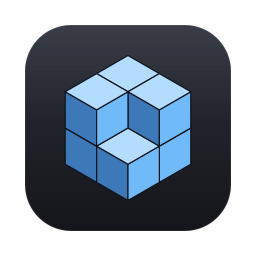
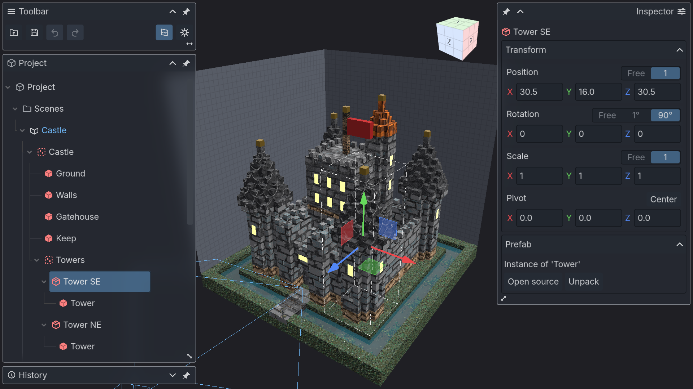
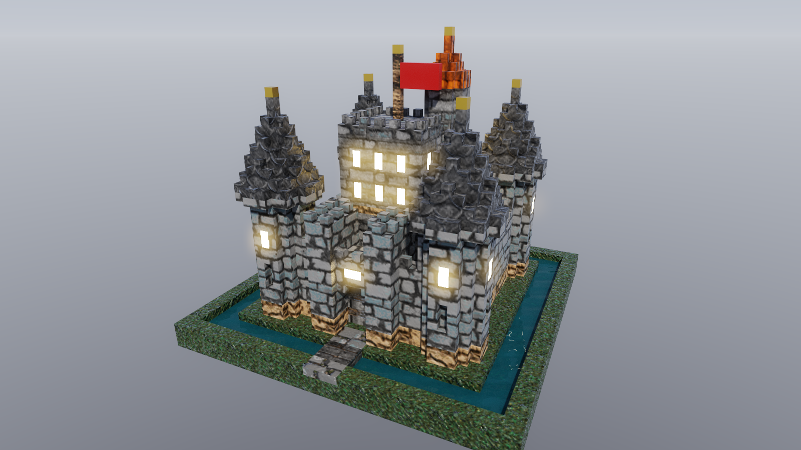

<p align="center">
  
</p>

<h1 align="center">VoxelCAD</h1>

<p align="center">
  A voxel editor that works like CAD — and that an AI agent can drive.
</p>

<p align="center">
  
  
  
  
  
</p>



VoxelCAD treats a voxel model the way CAD treats a part: a tree of named
elements with exact transforms, cells that snap to the grid, pivots, prefabs, and
one undo history for all of it. Every action is also a command, reachable over
[MCP](https://modelcontextprotocol.io), so an agent can build, inspect and render
a model the same way a person does — in the same window, with the person
watching.

## Features

- **Precise transforms.** Position, rotation and scale snap to whole cells and
  right angles, or run free; every element has a pivot; move, rotate and scale
  handles work on one element or a selection.
- **A real hierarchy.** Groups, multiple scenes in one project, and prefabs whose
  instances follow their source until you unpack them.
- **Editing tools.** Brush strokes, erase, eyedropper, flood fill, face
  extrusion by dragging, mirror planes, replace a material everywhere it is used.
- **Materials.** Colour, roughness, metal, emission and transparency, procedural
  surface patterns, and 300 scanned CC0 materials that ship with the editor.
- **A path tracer.** A GPU path-traced render beside the real-time viewport: soft
  sun shadows, glass, emissive lights, depth of field.
- **Import and export.** Reads MagicaVoxel `.vox` and Qubicle `.qb`; writes OBJ,
  STL, FBX and `.vox`.
- **References.** Images (PNG, JPEG, WebP, BMP) and models (glTF, OBJ, STL)
  placed in the scene to model over.
- **Agent control, out in the open.** An agent asks for the editor, the person
  sees a countdown and a plaque with the agent's name and topic, can stop it at
  any moment, and finds its edits grouped under its name in the history.



## Getting started

You need [Godot 4.7, .NET edition](https://godotengine.org/download) and the
[.NET SDK](https://dotnet.microsoft.com/download) 8 or newer.

```bash
git clone https://github.com/SVLubin/VoxelCAD.git
cd VoxelCAD
godot --headless --path . --build-solutions --quit   # build the C# projects
godot --path .                                       # run the editor
```

Or open the folder in the Godot editor and press Play. The first launch opens
a sample castle — four of its towers are instances of one prefab, and it carries
a camera, so the render works straight away. An agent opens it again with
`new sample=castle`.

To build a macOS app bundle:

```bash
GODOT=/path/to/Godot tools/export_macos.sh   # writes tmp/VoxelCAD.app
```

The editor is developed and tested on macOS. Godot also targets Windows and
Linux, but those builds have not been made or tested yet.

## Working with an agent

When the editor starts it serves MCP on `http://127.0.0.1:8971/mcp`, protected by
a bearer token, and writes a ready-made client config to `user://mcp.json` (on
macOS: `~/Library/Application Support/Godot/app_userdata/VoxelCAD/mcp.json`).
Point any MCP client at that file — for Claude Code, copy its `voxelcad` entry
into your `.mcp.json`.

An agent then has the same reach as the person at the keyboard:

| To… | Commands |
| --- | --- |
| build | `set-voxels`, `fill-box`, `fill-connected`, `extrude`, `mirror-element`, `set-transform` |
| read | `tree`, `element`, `bounds`, `slice`, `materials`, `history` |
| look | `frame`, `window`, `render`, `material-preview` |
| work with files | `open`, `save`, `import`, `export` |
| share the editor | `take-control`, `report-topic`, `release-control` |

Edits are refused until the agent holds control, so an agent and a person never
work at the same time. For testing the interface itself, an opt-in debug setting lets an
agent click, drag and type into the editor
([docs/agent-input.md](docs/agent-input.md)).

The same commands run without the editor through a headless CLI, as a script or
as an MCP server over stdio:

```bash
dotnet run --project tools/VoxelCAD.Cli -- --help
dotnet run --project tools/VoxelCAD.Cli -- --script build.txt --out part.vcad
dotnet run --project tools/VoxelCAD.Cli -- --mcp
```

## Tests

Eleven test projects cover every layer below the Godot nodes and run without an
engine:

```bash
for t in tests/*/; do dotnet test "$t"; done
```

## Documentation

- [docs/architecture.md](docs/architecture.md) — layers, the model, presenters and the command surface
- [docs/panels.md](docs/panels.md) — the panel chrome and its glass
- [docs/materials.md](docs/materials.md) and [docs/render.md](docs/render.md) — materials and the path tracer
- [docs/import.md](docs/import.md), [docs/export.md](docs/export.md) and [docs/references.md](docs/references.md) — files in and out
- [AGENTS.md](AGENTS.md) — the handbook AI agents work from

## Credits

- [Godot Engine](https://godotengine.org) — MIT
- [Inter](https://rsms.me/inter/) typeface by Rasmus Andersson — SIL Open Font License 1.1 ([assets/fonts/OFL-Inter.txt](assets/fonts/OFL-Inter.txt))
- [YamlDotNet](https://github.com/aaubry/YamlDotNet) — MIT
- The shipped materials are derived from CC0 texture sets by
  [Poly Haven](https://polyhaven.com), [ambientCG](https://ambientcg.com) and
  [cgbookcase](https://www.cgbookcase.com)
- `addons/beckett` — the Godot MCP bridge used during development — MIT ([addons/beckett/LICENSE](addons/beckett/LICENSE))

## License

MIT — see [LICENSE](LICENSE). Third-party components keep their own licenses, listed
under [Credits](#credits).
